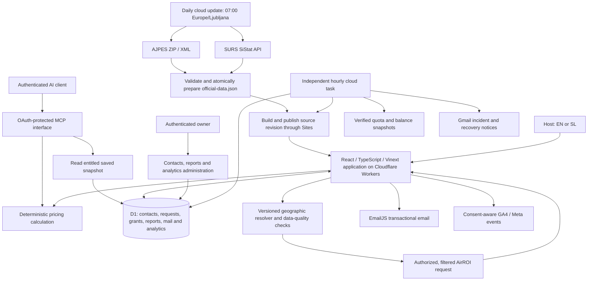
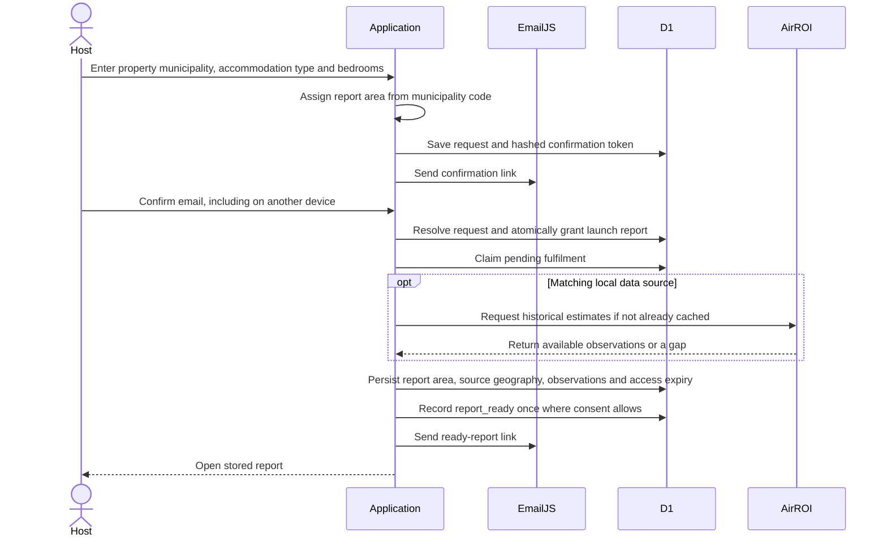

# Architecture and integrations

[Product overview](README.md) · [Product decisions](PRODUCT-DECISIONS.md)

**Production version 103 · 9 November 2026.** The calculator and the capped launch-report flow are public. The full report opens privately. Each property municipality maps to one report area, and every displayed price retains the geography of its source.

## AI interface added in Sprint 4

The customer MCP interface at `/ai/mcp` uses OAuth with account-scoped permissions and one-hour access tokens. `calculate_price` runs deterministic shared pricing logic. `get_market_report` supports reading an entitled stored report and preparing a request that requires separate website confirmation. New AI report requests remain disabled; calculation and saved-report reading continue to work.

Read contract 1.1.1 returns all available AJPES, SURS, AirROI and hotel context, source dates, units and limitations. A caller can attach unchanged calculation inputs to a read without creating another report. Hotel-room ADR describes listings for two guests with equal listing weights; a single listing is not a representative hotel market. SURS counts person-nights, and historical market revenue is not the host's profit.

Private traces record action, language, contract version, call identity and snapshot identity. The six EN/SL client scenarios were verified against those traces, with repeated reads preserving the snapshot and producing no extra orders, paid requests or email. Raw responses, private identifiers and paid datasets do not belong in this showcase.

The calculator and report form share municipality search. They carry the selected municipality, accommodation type and bedroom count between steps. Unfinished inputs survive language changes and a return from an article in the same tab. The v103 territorial report was checked at 200% zoom and at 320 CSS pixels. Reconnecting Claude after its session expires remains a separate follow-up.

## System map

Official data is currently shipped as a validated JSON bundle in the published source revision. Customer and workflow state is stored in D1. There is no claim that official municipal series live in separate production D1 import tables, or that an independently scheduled queue worker generates customer reports.

## Official-data refresh

The daily cloud task downloads AJPES and queries SURS outside visitor requests. It validates the pair, commits the generated source, builds and publishes through Sites. A local atomic rename prevents one source being activated without its paired dataset; a successful deployment determines which bundle the live application serves. Source dates, retrieval dates and completion time remain distinct.

### AJPES

The [RNO export](https://www.ajpes.si/RNO/RNO.zip) contains registered accommodation establishments. The importer uses the establishment municipality, rather than the operator's postal address, selects active records and aggregates accommodation types and registered capacity.

The bundle covers all 212 municipalities. Beds, accommodation units and unknown capacity remain distinct measures. The public free count is a narrower projection than the report's detailed supply context. Raw register rows and operator details are not public report payloads.

### SURS

[SiStat table 2164466S](https://pxweb.stat.si/SiStatData/pxweb/en/Data/-/2164466S.px/) provides municipal tourist arrivals and overnight stays. The importer resolves dimensions from metadata, queries the published periods and retains missing/suppressed observation flags.

For a report area, the annual total and its monthly breakdown use the same municipalities with observations for all 12 months. The report names the year, how many municipalities contributed and how many belong to the area. One guest staying one night counts as one overnight stay. A missing month stays missing.

A failed refresh must retain the last valid published pair. The data-quality checks assess age and completeness separately from the schedule being enabled.

## Geography and AirROI

Each of Slovenia’s 212 official municipality codes maps to exactly one of 15 report areas. Ljubljana, Piran, Bled, Kranjska Gora and Bohinj have their own areas. The other 207 municipalities form ten groups. A separate provider catalogue identifies the source locality and describes its relationship to the municipality. Group figures and locality prices keep their own geographic labels.

The server filters historical price data by accommodation type and bedroom count, validates the locality and keeps its months separate. An unexplained 404 leaves the cause open. An explicitly empty series and a failed request have distinct messages. The rest of the territorial report remains available in each case.

The price block identifies historical nightly-rate ADR, excludes separate cleaning fees and describes values before host commission. It is not a forecast or the total guest bill. Monthly distributions retain their periods; averages of monthly statistics must not be labelled an annual median.

Reports store the derived result, official context, geography version, quality warnings and generation date. Private access expires after 30 days; reopening does not reset the deadline or make a new AirROI request. External-provider rights and retention requirements continue to govern the data. [AirROI API documentation](https://www.airroi.com/api/documentation)

## Hotel history and published offers

The monthly country-wide AirROI collection covers hotel and boutique-hotel listings declared for two guests. The October snapshot contains 100 listings across 43 provider areas, with positive observed prices in 35 areas during the historical window. These are coverage observations, not a census of Slovenian hotels. A standard room category is not established by these filters.

Derived monthly statistics are equally weighted across eligible listing ADRs. A single observation is labelled as one observation, not a market range. Small samples carry a caution; absent prices leave an explicit gap while other report sections remain available. Customer report requests read the stored hotel cache rather than purchasing the national collection again.

The existing weekly radar supplies published offers from official hotel websites. Its October snapshot has 16 sources and 93 accommodation-offer records after filtering. From-prices, packages, per-person rates, dates and source links retain their meaning; expired and stale offers are hidden. They are not pooled into the historical hotel median.

A personal price comparison requires a real saved calculation and a valid comparable reference. Direct market reviews do not invent a personal quote. Entire homes and hotel rooms remain different products with a visible explanation.

## Direct report and calculator-to-report paths

Direct requests store the selection without inventing calculator inputs. Calculator-originated requests preserve the actual inputs and selected municipality. Confirmation resumes the persisted request, so a different device does not depend on the first browser's local state.

The launch grant is unique per verified email and municipality. An atomic database operation enforces the global 50-report limit, including failed or uncertain reservations. A repeat request reuses the grant and its original selection.

Fulfilment is an application function protected by an atomic database claim. Request handling and Cloudflare `waitUntil` where used protect execution against an early browser disconnect; durable states make interrupted work detectable. This is not a guarantee of an independently running job queue. Unknown billable-call outcomes are held for review instead of blindly retried.

Report readiness, grant/payment status and email delivery are separate. Provider acceptance is recorded as acceptance, not proof of inbox delivery. A failed email does not erase a ready report. Resending an eligible ready-result link reuses the stored report; unknown send outcomes require reconciliation.

## Retained payment path

The application contains a €5 Stripe Checkout path, guarded by runtime configuration and an explicit sales flag. It requires a confirmed contact and authorized saved calculation. Signed payment events are checked against order identity, mode, currency, amount and pinned geography.

Repeated events and concurrent claims are deduplicated. Failed fulfilment has a recorded refund path; uncertain supplier and refund outcomes remain visible. The existence and testing of this code do not mean live paid sales are enabled. The current public launch report is granted at zero charge and does not invoke Stripe.

## Persistent state and access

| Stored group | Purpose |
| --- | --- |
| Contacts and consent events | Address verification, language, optional marketing consent and withdrawals |
| Free results and report requests | Persisted inputs or selections, confirmation state and continuation |
| Orders / launch grants | Immutable entitlement, selected market, fulfilment and delivery states |
| Saved report payloads | Derived market result, source context, warnings and expiry |
| Mail attempts and locks | Shared quota reservations and controlled transactional sending |
| Analytics events and resource context | Deduplicated journey events, attribution, consent and internal-test classification |
| Stripe events and feedback | Payment-event deduplication and report feedback |

D1 is accessed through server code and Drizzle-managed schema/migrations. Owner administration uses platform sign-in plus server authorization. Customer report access requires a valid session or authorized expiring link; knowing a record identifier alone is insufficient.

Confirmation secrets are hashed and expire. Rate limits, same-origin checks, payload validation and bounded quota reservations protect the public flows. Credentials and raw provider payloads are not published in this showcase.

## Search, articles and attribution

Article content is stored as an EN/SL JSON pair with shared translation identity, localized metadata, sources and images. Registration in the article catalogue drives the indexes and generated sitemap. The page template supplies canonical/language links, Open Graph and Article structured data.

Public article pages return complete server-rendered text and localized metadata, clean self-canonical URLs and reciprocal language URLs. The fixed `/go/bled-en` and `/go/bled-sl` aliases return an HTTP 302 to their allowlisted article and campaign. Query input cannot replace the destination. Unknown aliases return 404. Internal links and CTA paths do not add UTM parameters.

The report landing pages have localized public share cards. Private result pages are excluded from public discovery.

Sixteen allowlisted material links use distinct `utm_campaign` values for organic posts and paid variants. Unknown values are sanitized; `utm_content` and `utm_term` are not retained. This bounded approach distinguishes materials through the ready-report event without accepting arbitrary URL text into analytics. Article assistance is retained as a separate context.

GA4 browser and server events respect analytics consent. Meta measurement requires its separate advertising consent. Duplicate confirmation and reopening do not emit another ready-report conversion. Owner/friend tests are identified separately when interpreting demand; a nominally external browser session is not automatically a real lead.

## Operations and independent monitoring

The existing main task runs hourly at minute 00. It runs the watchdog, gates the daily official-data publication to the morning window, prepares the 08:00 digest, and runs the monthly hotel stage only when due. A separate hourly task at minute 03 checks the service. Actual start times depend on the cloud queue.

| Process | Cadence and responsibility |
| --- | --- |
| AJPES/SURS | Daily 07:00 local publication of the validated pair |
| Independent monitor | Hourly minute 03; service freshness, reports, mail, resources and incidents |
| Watchdog | Hourly minute 00; missing, stalled or incomplete monitoring |
| Daily digest | 08:00 Europe/Ljubljana; previous 24 hours, including zero orders and unresolved incidents |
| Hotel cache | 20th of the month, 07:00 Europe/Ljubljana; first paid scheduled cycle on 20 November |
| Published-offer radar | Existing weekly review and validated import |

Owner-only tools persist runs, incident transitions, notifications, resource snapshots and digest states in D1. The operations dashboard uses these records and distinguishes source import from a verified deployment. City or district names are readable and colored dots accompany written statuses.

Incident/recovery messages and the digest use connected Gmail independently of transactional EmailJS. Deduplication and atomic claims prevent routine repeats. A send with an unknown outcome requires reconciliation; acceptance by a provider is not inbox-delivery proof. The digest stores separate Sent and Inbox evidence after verification.

The full observation window from 29 October 15:07:50 to 30 October 15:08:28 Europe/Ljubljana recorded 24 successful monitor runs, 24 successful watchdog runs, a published and verified official-data refresh and a verified daily digest with one sending attempt. The longest monitor/watchdog intervals were under 69 minutes, within the 90-minute threshold. No new incident transitions appeared. One older mail reservation remains unresolved and was not resent. Service code was unchanged across v89/v90/v91; this is not a 24-hour observation of the new v91 AI explanations. Full delivery identifiers remain private.

The mail sender counts local attempts against the last observed shared allowance and keeps a reserve of ten messages. The age of the observation or the expected reset date alone does not stop delivery or imply replenishment. A low remaining estimate or actual delivery error prompts reconciliation.

The hotel stage requires a balance observation no older than 24 hours, enforces a $15 monthly limit and $5 client-report reserve, and does not buy a completed month again. A failed refresh keeps the usable prior cache and does not block the main report. November's first paid cycle remains a future verification.

## Build and validation boundary

The private application uses Node.js 22.13 or newer, pnpm, React, TypeScript, Vinext/Vite, Cloudflare Workers, D1 and Drizzle. The repository's lockfile pins its build inputs.

The maintained deployment workflow is: retrieve the Site's source; install its locked dependencies; run the relevant unit/runtime checks, TypeScript and production build; synchronize the verified source revision; package and publish through Sites; verify the deployed result. Runtime secrets are configured through Sites and are not placed in source-control examples.

The broader pre-v91 baseline passed 195 automated tests. The v91 change touched AI unit metadata, explanation guidance and a regression test; 18 targeted AI/hotel tests, TypeScript and production build passed. Six live EN/SL scenarios were traced, followed by two v91 saved-report reads. Earlier built-Worker and attribution checks used intercepted provider and email/Meta responses. These checks verify software behaviour; they do not establish campaign performance, customer adoption or complete editorial acceptance.

This showcase is documentation-only and cannot be built or deployed as the application. A transfer of private application source, configuration and operating credentials is a separate repository handover.

