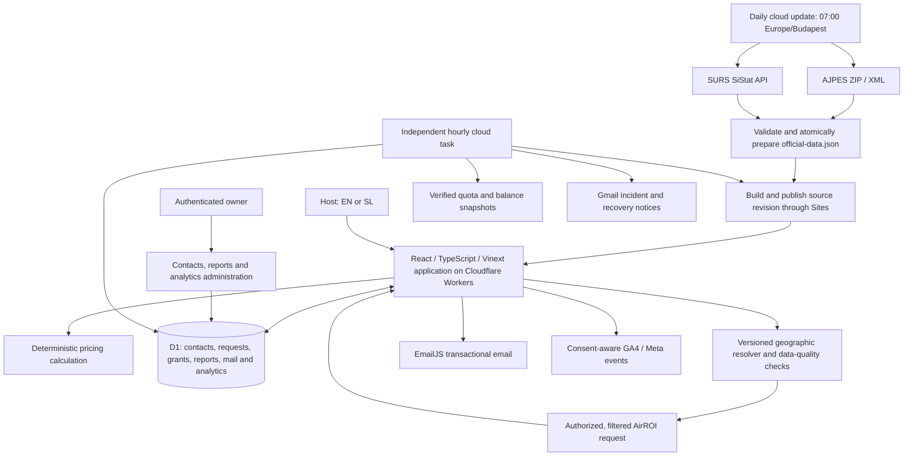

# Architecture and integrations

[Product overview](README.md) · [Product decisions](PRODUCT-DECISIONS.md)

**Implemented architecture at 16 October 2026 (version 44).** The public service offers a free calculator and a capped launch-report flow. The application also contains a separately gated Stripe payment path. Paid sales are disabled at this checkpoint.

## System map



Official data is currently shipped as a validated JSON bundle in the published source revision. Customer and workflow state is stored in D1. There is no claim that official municipal series live in separate production D1 import tables, or that an independently scheduled queue worker generates customer reports.

## Official-data refresh

The daily cloud task downloads AJPES and queries SURS outside visitor requests. It validates the pair, commits the generated source, builds and publishes through Sites. A local atomic rename prevents one source being activated without its paired dataset; a successful deployment determines which bundle the live application serves. Source dates, retrieval dates and completion time remain distinct.

### AJPES

The [RNO export](https://www.ajpes.si/RNO/RNO.zip) contains registered accommodation establishments. The importer uses the establishment municipality, rather than the operator's postal address, selects active records and aggregates accommodation types and registered capacity.

The bundle covers all 212 municipalities. Beds, accommodation units and unknown capacity remain distinct measures. The public free count is a narrower projection than the report's detailed supply context. Raw register rows and operator details are not public report payloads.

### SURS

[SiStat table 2164466S](https://pxweb.stat.si/SiStatData/pxweb/en/Data/-/2164466S.px/) provides municipal tourist arrivals and overnight stays. The importer resolves dimensions from metadata, queries the published periods and retains missing/suppressed observation flags.

The latest published month may be older than the retrieval date. Comparable-period calculations require available observations and a valid denominator. Guest overnight stays describe the statistical table's population, not property occupancy in the commercial sample.

A failed refresh must retain the last valid published pair. The data-quality checks assess age and completeness separately from the schedule being enabled.

## Geography and AirROI

A versioned catalogue retains exact AirROI market identifiers, official municipality association, boundary status and review evidence. The resolver checks the selected market and its relationship to the municipality. Broader or otherwise non-exact coverage must be labelled explicitly; the service does not silently present a different territory as an exact municipal match.

AirROI requests run on the server with property-type and bedroom filters and a historical reference window. The adapter validates response geography, months, values and distribution ordering. Missing or inadequate coverage is reported rather than replaced with a fabricated estimate.

The price block identifies historical nightly-rate ADR, excludes separate cleaning fees and describes values before host commission. It is not a forecast or the total guest bill. Monthly distributions retain their periods; averages of monthly statistics must not be labelled an annual median.

Reports store the derived result, official context, geography version, quality warnings and generation date. Private access expires after 30 days; reopening does not reset the deadline or make a new AirROI request. External-provider rights and retention requirements continue to govern the data. [AirROI API documentation](https://www.airroi.com/api/documentation)

## Direct report and calculator-to-report paths

```mermaid
sequenceDiagram
    actor Host
    participant App as Application
    participant Mail as EmailJS
    participant DB as D1
    participant Market as AirROI
    Host->>App: Select area and property; optional calculation
    App->>DB: Save request and hashed confirmation token
    App->>Mail: Send confirmation link
    Host->>App: Confirm email, including on another device
    App->>DB: Resolve request and atomically grant launch report
    App->>DB: Claim pending fulfilment
    App->>Market: Fetch validated, eligible market selection
    Market-->>App: Historical estimates
    App->>DB: Persist report, provenance and access expiry
    App->>DB: Record report_ready once where consent allows
    App->>Mail: Send ready-report link
    App-->>Host: Open stored report
```

Direct requests store the selection without inventing calculator inputs. Calculator-originated requests preserve the actual inputs and selected municipality. Confirmation resumes the persisted request, so a different device does not depend on the first browser's local state.

The launch grant is unique per verified email and municipality. An atomic database operation enforces the global 50-report limit, including failed or uncertain reservations. A repeat request reuses the grant and its original selection.

Fulfilment is an application function protected by an atomic database claim. Request handling and Cloudflare `waitUntil` where used protect execution against an early browser disconnect; durable states make interrupted work detectable. This is not a guarantee of an independently running job queue. Unknown billable-call outcomes are held for review instead of blindly retried.

Report readiness, grant/payment status and email delivery are separate. Provider acceptance is recorded as acceptance, not proof of inbox delivery. A failed email does not erase a ready report. Resending an eligible ready-result link reuses the stored report; unknown send outcomes require reconciliation.

## Retained payment path

The application contains a €5 Stripe Checkout path, guarded by runtime configuration and an explicit sales flag. It requires a confirmed contact and authorized saved calculation. Signed payment events are checked against order identity, mode, currency, amount and pinned geography.

Repeated events and concurrent claims are deduplicated. Failed fulfilment has a recorded refund path; uncertain supplier and refund outcomes remain visible. The existence and testing of this code do not mean live paid sales are enabled. The current public launch report is granted at zero charge and does not invoke Stripe.

## Persistent state and access

| Stored group | Purpose |
| --- | --- |
| Contacts and consent events | Address verification, language, optional marketing consent and withdrawals |
| Free results and report requests | Persisted inputs or selections, confirmation state and continuation |
| Orders / launch grants | Immutable entitlement, selected market, fulfilment and delivery states |
| Saved report payloads | Derived market result, source context, warnings and expiry |
| Mail attempts and locks | Shared quota reservations and controlled transactional sending |
| Analytics events and resource context | Deduplicated journey events, attribution, consent and internal-test classification |
| Stripe events and feedback | Payment-event deduplication and report feedback |

D1 is accessed through server code and Drizzle-managed schema/migrations. Owner administration uses platform sign-in plus server authorization. Customer report access requires a valid session or authorized expiring link; knowing a record identifier alone is insufficient.

Confirmation secrets are hashed and expire. Rate limits, same-origin checks, payload validation and bounded quota reservations protect the public flows. Credentials and raw provider payloads are not published in this showcase.

## Search, articles and attribution

Article content is stored as an EN/SL JSON pair with shared translation identity, localized metadata, sources and images. Registration in the article catalogue drives the indexes and generated sitemap. The page template supplies canonical/language links, Open Graph and Article structured data.

The report landing pages have localized public share cards. Private result pages are excluded from public discovery.

Twelve allowlisted material links use distinct `utm_campaign` values for organic posts and paid variants. Unknown values are sanitized; `utm_content` and `utm_term` are not retained. This bounded approach distinguishes materials through the ready-report event without accepting arbitrary URL text into analytics. Article assistance is retained as a separate context.

GA4 browser and server events respect analytics consent. Meta measurement requires its separate advertising consent. Duplicate confirmation and reopening do not emit another ready-report conversion. Owner/friend tests are identified separately when interpreting demand; a nominally external browser session is not automatically a real lead.

## Operations and independent monitoring

Two distinct cloud schedules exist:

| Task | Cadence | Responsibility |
| --- | --- | --- |
| Official-data update | Daily at 07:00, Europe/Budapest | Retrieve, validate and publish the AJPES/SURS pair |
| Independent health check | Hourly, minute 03 | Check freshness, stuck reports/mail, quota evidence, promo capacity and AirROI balance |

The independent checker uses the current published source revision, bounded database reads and nonsecret quota metadata. It sends incident/recovery notices through connected Gmail, independently of EmailJS. Sent notices provide durable deduplication state. Normal unchanged checks stay quiet; a failure to inspect inputs or deliver a notice must remain visible.

Quota and balance snapshots are verified observations, not live counters. Shared accounts may be consumed by other applications. The checker must distinguish stale evidence from an exhausted account and must not infer a fresh balance.

On 16 October, an unattended hourly run reported the refreshed EmailJS snapshot and produced a recovery notice. Historic silent-run coverage is not inferred from the absence of messages. Full acceptance evidence is retained in the private operational record.

## Build and validation boundary

The private application uses Node.js 22.13 or newer, pnpm, React, TypeScript, Vinext/Vite, Cloudflare Workers, D1 and Drizzle. The repository's lockfile pins its build inputs.

The maintained deployment workflow is: retrieve the Site's source; install its locked dependencies; run the relevant unit/runtime checks, TypeScript and production build; synchronize the verified source revision; package and publish through Sites; verify the deployed result. Runtime secrets are configured through Sites and are not placed in source-control examples.

At the Sprint 2 checkpoint, 98 unit tests, TypeScript and build passed, together with 12 existing runtime groups and 12 attribution journeys. Provider responses and outbound email/Meta calls in those runtime tests are intercepted. These checks verify software behaviour; they do not establish campaign performance or customer adoption.

This showcase is documentation-only and cannot be built or deployed as the application. A transfer of private application source, configuration and operating credentials is a separate repository handover.
