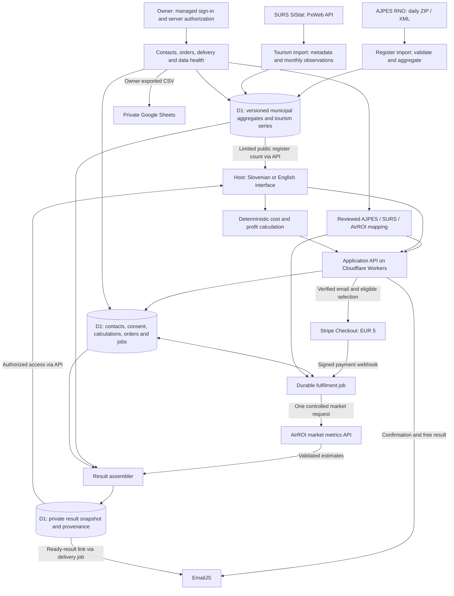

# Architecture and integrations

[Product overview](README.md) · [Product decisions](PRODUCT-DECISIONS.md)

**Target architecture for the completed first release.** The system combines a host's cost calculation, official accommodation supply, municipal tourism history and a purchased market comparison. This document specifies the intended end-to-end design; the [implementation checkpoint](README.md#implementation-checkpoint--7-october-2026) records what is currently delivered.

## System map



The diagram separates scheduled official-data imports from customer-triggered market requests. A page visit never downloads the register or spends AirROI credits. The connectors meet in the result assembler through reviewed geography and explicit source versions. All database access and external credentials remain behind server code; arrows describe logical data flows.

## Integration contracts

| Integration | Access and trigger | Input | Output used by Adaptix |
| --- | --- | --- | --- |
| AJPES RNO | Public bulk download; daily import | ZIP containing XML | Municipality catalogue, active-establishment counts, type and capacity aggregates |
| SURS SiStat | Public PxWeb API; check after monthly publication, with bounded retries | Table metadata and a filtered statistical query | Monthly guest overnight stays, observation flags and publication vintage |
| AirROI | Server-only API key; reviewed geography during setup, market metrics after payment | Exact market identifiers, room type, bedrooms and historical window | Validated aggregate price distributions and listing counts, with available monthly metrics |
| Stripe | Server-created Checkout and signed webhook | Verified contact, immutable selection, EUR 5 order | Payment status and payment identifiers |
| EmailJS | Server-side transactional send | Confirm-address message or authorized result link | Provider acceptance or error recorded against a message attempt |
| Owner identity | Platform-managed sign-in + application authorization | Authenticated identity | Access to private administration |
| Google Sheets | Manual CSV import by the owner | Selected contact and order columns | Private working copy; the application remains the source of truth |

## 1. AJPES: download, normalize and publish supply aggregates

AJPES publishes [RNO.zip](https://www.ajpes.si/RNO/RNO.zip), containing XML with active, inactive and deleted establishments. The daily export reflects the register at the preceding day. [Official format and frequency](https://www.ajpes.si/Registri/Drugi_registri/Register_nastanitvenih_obratov/Splosno)

The target import pipeline is:

1. Download once in a scheduled backend job. Record the source URL, retrieval time, source snapshot date and input hash.
2. Unpack and parse `RNO.xml`. Validate its structure, establishment identifiers, status values and municipality codes. Duplicate identifiers, empty downloads and unexpected schema changes fail the candidate import.
3. Use `aoi/aot` for the **establishment's municipality**. The operator's address (`nasoi/nasot`) does not define the market. Preserve code-based aliases and use SURS metadata to complete the 212-municipality catalogue when a municipality has no rows in a snapshot.
4. Select active records (`s=1`). Aggregate by municipality and original accommodation type (`kgt`), and by registered-bed bands (`l`). Preserve accommodation units (`nNe`) as a separate measure and unknown capacity as unknown.
5. Stage normalized aggregates, run consistency checks and activate the new dataset version atomically. Keep the last valid version on failure; expose its date and the import error in administration.

The free projection contains municipality identifiers and the approved count for apartment, room and holiday-home categories, including reviewed historical label variants. The paid projection adds type and capacity breakdowns. It identifies whether a breakdown covers the selected categories or the whole register. These rules come from the project's inspected XML and importer contract and are revalidated against each source schema.

Operator details and individual register rows are not part of the public payload. Raw downloads are restricted import material and are removed after the controlled processing/diagnostic window; source hashes, dates and aggregate versions remain for traceability. A register count describes registered establishments at a date, not occupied properties or platform listings.

## 2. SURS: retrieve published tourism history

The source is [SiStat table 2164466S](https://pxweb.stat.si/SiStatData/pxweb/en/Data/-/2164466S.px/), which contains monthly tourist arrivals and overnight stays by municipality and country of origin. The integration uses its [PxWeb API endpoint](https://pxweb.stat.si/SiStatData/api/v1/en/Data/2164466S.px).

1. `GET` the table metadata to resolve current dimension codes, municipal identifiers, available months and measure labels. Read and retain the table's publication/update evidence separately from retrieval time.
2. `POST` a filtered query for the chosen municipal codes, all countries of origin and **guest overnight stays**, requesting `json-stat2`. Retrieve enough published history for monthly seasonality and comparison with the same months a year earlier; the target window is at least 24 months where available.
3. Decode observations by the returned dimension indexes. Store municipality code, month, value, unit, source status flag and publication vintage. Missing or suppressed cells remain missing. Unknown measure codes stop the import instead of selecting a different statistic.
4. On each publication refresh, re-read the comparison window to capture revisions. Stage and activate a valid version; an interrupted refresh keeps the previous dated series.

The paid result displays municipal overnight-stay history and a same-period change only when both periods are comparable. A zero denominator or unavailable observation produces an unavailable comparison, not a fabricated percentage. This is guest-night context across the table's accommodation scope; it is not the occupancy rate of the host's property or of the AirROI sample.

## 3. Geography: the join between the sources

Municipality is the first-release unit of selection. The client submits a stable official code; the server resolves supplier parameters from a versioned table.

| Mapping field | Purpose |
| --- | --- |
| AJPES area code, official name and level | Identifies the municipality shown to the host |
| SURS area code | Selects the matching statistical series |
| AirROI country, region, locality and optional district | Preserves the provider's exact accepted identifiers |
| Review status and boundary evidence | Records whether the supplier market actually matches the municipality |
| Mapping version and review date | Reproduces the selection purchased by the customer |

AirROI market discovery is a controlled setup activity using its search API. A name match or successful response is insufficient: boundaries must also be reviewed. Unknown, broader or narrower matches remain unavailable for this municipality-based release. The same server resolver gates both checkout and fulfilment, and the order pins the reviewed mapping version. A revoked mapping stops fulfilment for review rather than switching the customer to a different market.

This is an **area-level join**, not a property-level match. Registered beds, bedrooms, accommodation units, active listings and guest overnight stays retain their own units. Countrywide free-register coverage does not imply countrywide paid-market coverage.

## 4. AirROI: request and validate the purchased market snapshot

After confirmed payment, the fulfilment worker calls `POST https://api.airroi.com/markets/metrics/all` with a server-held `X-API-KEY`. The request contains the pinned market identifiers, explicit `room_type` and `bedrooms` filters, `num_months: 12` and `currency: native` (EUR for Slovenia). [API contract](https://www.airroi.com/api/documentation)

The adapter validates response geography, returned months, non-negative values, occupancy ranges and percentile ordering. Missing values stay missing; an empty response or 404 is unavailable data. It never silently broadens the geography or property filters to obtain a result.

The result uses a labelled returned period for the median and middle 50% price range, with the provider's active-listing count for that period. It does not describe an average of monthly medians as an annual median, or a listing count as a verified booking sample. Additional returned metrics are normalized only as needed for the purchased result.

Before displaying a price comparison, the adapter's metric contract must establish the treatment of fees and the represented period. The host's separate cleaning charge remains visible; a nightly rate is not presented as directly equivalent to an all-in booking total. An unresolved definition blocks that comparison rather than producing a misleading percentage difference.

Only a compact derived result is exposed to the customer. AirROI attribution and the estimated nature of its figures are displayed. The product's access period is capped at 30 days and shortened if the applicable supplier terms require it; reopening does not reset expiry. Supplier payloads and derived snapshots are expired under the same retention policy, while payment records remain separate. This design is subject to the applicable licence and distribution conditions, including the conditional safe harbor; the showcase makes no blanket redistribution claim. [AirROI terms, sections 5 and 10](https://www.airroi.com/tos)

## 5. Payment, fulfilment and delivery

```mermaid
sequenceDiagram
    actor Host
    participant App as Application API
    participant Email as EmailJS
    participant Stripe
    participant Job as Durable order job
    participant Market as AirROI
    participant DB as D1
    Host->>App: Select municipality, category and bedrooms
    App->>App: Check reviewed coverage and confirmed email session
    opt Email needs confirmation
        App->>Email: Send one-time confirmation link
        Host->>App: Confirm address and resume saved selection
    end
    App->>DB: Save immutable EUR 5 order and mapping version
    App->>Stripe: Create Checkout for this order
    Stripe-->>App: Signed paid webhook
    App->>DB: Validate payment; atomically record event and enqueue job
    App-->>Stripe: Acknowledge persisted event
    Job->>DB: Claim fulfilment and record supplier attempt
    Job->>Market: Fetch exact purchased market slice
    Market-->>Job: Return historical estimates
    Job->>DB: Save validated result with AJPES/SURS versions
    Host->>App: Open saved result
    App->>DB: Read authorized result
    App-->>Host: Serve saved result
    Job->>Email: Send ready-result link
    Email-->>Job: Return provider outcome
    Job->>DB: Record message status
```

Checkout requires a valid confirmed-email session on the server, including for direct API requests. An email merely existing in the contact table does not authorize a purchase or saved-result access. Marketing consent is never a payment prerequisite.

The webhook validates the signature, successful payment state, order association, currency `EUR` and amount `500` cents. Unique event/order keys and an atomic claim prevent concurrent or repeated delivery from initiating duplicate fulfilment. Browser redirects do not mark orders as paid.

The result job is durable and independent of the checkout page and webhook response. It pins the calculation, selection, source versions and supplier attempt. Payment, result readiness and email status are separate state machines. If an external call times out after possibly consuming credits, its outcome is marked uncertain for reconciliation; the system does not promise exactly-once execution across an external API or retry a billable call blindly.

An email error leaves a ready result accessible on the site. The owner can resend its link without refetching AirROI. A paid order that cannot be fulfilled is visible for refund; the first release supports the owner issuing that refund in Stripe Dashboard and recording the outcome.

## Application, storage and operations

React and TypeScript provide the Slovenian and English interface. Vinext/Vite builds the Cloudflare Worker application deployed through OpenAI Sites. Drizzle manages the D1 schema. Pricing is deterministic in the browser and revalidated on the server when saving or assembling a result.

Official-source imports run outside interactive requests as scheduled backend jobs, with a protected manual retry for the owner. The AJPES adapter follows the existing validated Python import rules; the deployment runner must enforce bounded execution and publish through a restricted ingestion path. SURS has a separate publication-aware refresh schedule. D1 stores normalized series and aggregates, not a public copy of raw source downloads. Each import records its candidate version, validation outcome and activation time.

| Logical data group | Contents and relationship |
| --- | --- |
| Contacts and consent events | Stable contact ID, normalized email, language, verification, source/UTM and versioned opt-in/withdrawal events |
| Saved calculations | Contact/access reference, entered costs, fees, cleaning-charge choice, formula version and saved result |
| Source imports and municipal data | Source hash/vintage, retrieval time, import status, aggregate version and municipality/month observations |
| Geographic mappings | Official codes, exact provider identifiers, review evidence, status and version |
| Orders and payment events | Contact, immutable purchased selection, amount, Stripe references and deduplicated payment events |
| Fulfilment jobs and supplier attempts | Order, claim state, call fingerprint, timing, outcome and cost/accounting evidence |
| Result snapshots | Calculation, market slice, AJPES/SURS versions, block-level provenance and access/retention expiry |
| Message attempts | Purpose, related calculation/order, provider acceptance/error and bounded resend state |

These are target logical groups, not a claim that all corresponding tables already exist. The order's comparison is pinned when assembled: later official-data refreshes do not silently rewrite a purchased snapshot. Editing the host's costs changes its calculated overlay without a new market request.

Owner administration covers contacts, orders, delivery and data health. It shows last successful imports, the dates actually served, mapping eligibility, failed or uncertain supplier calls and result-generation errors. Application state is authoritative; CSV imports into private Google Sheets are dated working copies. Exported contacts are not automatically a marketing list.

The public calculator remains usable if an external source is down. A failed official-data refresh preserves the last valid dated dataset and marks it stale. Before checkout, coverage and source availability rules determine whether the promised comparison can be sold; missing optional context is disclosed, and a missing core market result cannot be marked fulfilled.

## Pricing model and verification

Let `N` be nights per booking, `B` cleaning and laundry cost per booking, `V` variable cost per night, `F` monthly fixed costs, `O` expected occupied nights, `P` desired profit per night, `c` channel commission and `S` the separate cleaning charge to the guest:

```text
C = B / N + V + F / O
nightly rate = max(0, ceil(((C + P) * N / (1 - c) - S) / N))
booking total = nightly rate * N + S
payout = booking total * (1 - c)
profit before income tax = payout - C * N
```

For the break-even rate, `P = 0`. For cleaning included in the nightly rate, `S = 0`; actual cleaning cost remains in `B`. Positive stay/occupancy denominators and a commission below 100% are required. Whole-euro upward rounding and omitted host costs are explained in the result.

Release acceptance covers formula invariants; malformed imports and atomic rollback; missing SURS observations and revisions; geographic mismatch; confirmed-email access; signed payment validation; duplicate/concurrent events; uncertain billable calls; result persistence, refund and email-failure recovery; expiry; and EN/SL mobile use. Synthetic provider fixtures support repeatable checks without spending customer-funded API credits.

Private results and administration require server authorization. Secrets stay server-side, confirmation tokens are hashed and expire, transactional email requests are rate-limited, and CSV exports exclude tokens and supplier payloads. Proposed retention is seven days for unconfirmed requests, 90 days for free saved calculations and up to 30 days for market snapshots. Payment retention is separate; deployed cleanup and Privacy must agree before release.
