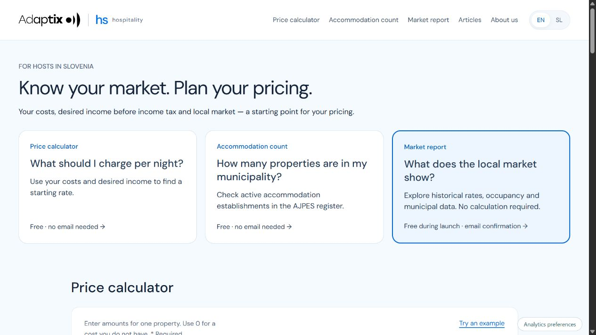
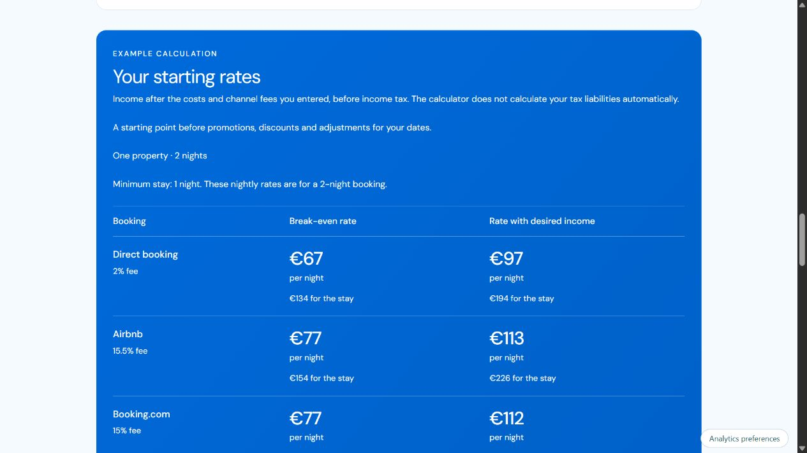
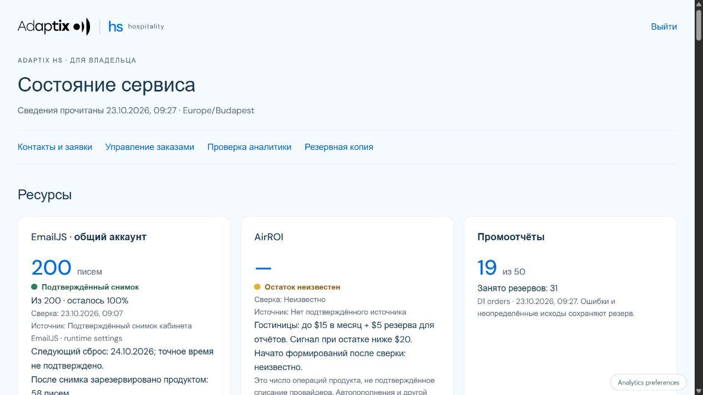

# Adaptix Hospitality

**Pricing and local market intelligence for independent accommodation hosts in Slovenia.**

[Product](https://adaptix-hs.eu) · [Request a report](https://adaptix-hs.eu/report) · [Slovenian report page](https://adaptix-hs.eu/sl/porocilo) · [Architecture](ARCHITECTURE.md) · [Product decisions](PRODUCT-DECISIONS.md)

Adaptix Hospitality helps a host answer three connected questions: **What nightly rate covers my costs? How does my price compare with the local market? What do official data tell me about accommodation supply and tourism in my municipality?**

The live service combines a free cost calculator with a limited launch offer of **50 free market reports**, subject to availability and supported geography. A report can be requested directly or after using the calculator. Email confirmation is required; a marketing subscription is optional.

**Sprint 4 checkpoint, 30 October 2026 (production version 93).** The AI integration and technical checks below are verified; final editorial review and sprint acceptance remain open. The earlier €5 purchase design remains separately gated, with paid sales disabled.

The homepage now offers three explicit entry points: request a market report, calculate a starting nightly rate, or view free registered-supply information for a municipality. English and Slovenian navigation consistently includes About us.

## Who it serves

An independent host renting a room, apartment or holiday home, often as a source of additional income. The host needs an understandable price calculation and a local reference without maintaining a spreadsheet or subscribing to a professional revenue-management platform. The interface and educational articles are available in Slovenian and English.

## The live product experience

### Work out your starting rates

Enter the length of the stay, cleaning and laundry costs per booking, nightly running costs, monthly fixed costs, expected occupied nights and a target profit. Editable commissions support direct bookings, Airbnb and Booking.com.

The result is a starting point before promotions, discounts and date-specific adjustments. A new visit starts with clean inputs; a saved confirmation link still opens its own result. The result follows the form on all screen sizes and has no independently scrolling panel. Minimum stay and nights in this calculation are separate inputs. The result shows a rate covering entered costs and a rate with the requested income, plus booking totals and income after channel fees. A separate cleaning charge is an optional user-selected scenario; cleaning remains an expense. Taxes already included in entered costs or fees stay included and should not be added twice.

The free municipality section shows dated AJPES registered-supply information without requiring a calculation or email. Official-data coverage includes all 212 Slovenian municipalities; commercial market coverage is checked separately.

### Request a market report

Choose the municipality, accommodation category and bedroom count, provide an email address and confirm it. Direct report requests do not require invented cost inputs. Requests made after a calculation carry its selected area and inputs into the report.

| Report section | What it contributes |
| --- | --- |
| **My price and the market** | Historical AirROI nightly-rate estimates, reference period and market coverage; a personal price overlay when a calculation was supplied |
| **Hotel context** | Historical AirROI rates for rooms listed for two guests, plus a separate selection of published offers from the hotel radar, where covered |
| **Registered accommodation supply** | AJPES active-establishment counts, types and registered capacity |
| **Tourism context** | SURS municipal guest-night history, seasonality and available comparable periods |

One launch grant is tied to a verified email and municipality. Reopening an existing report reuses its stored snapshot; it does not fetch another commercial dataset. Access expires after 30 days. Provider failures and uncertain outcomes remain visible for review rather than triggering an uncontrolled repeat request.

The ready result opens on the site and is linked in a transactional email. Report readiness and email delivery are tracked separately.

## Connected AI use

An authenticated Claude connection can run the same deterministic price calculation and read the account's accessible saved reports. Six separate English/Slovenian scenarios were exercised: calculation, report reading, and a combined explanation in each language. Server traces identify the action, language and immutable report snapshot.

Reading an existing report reuses its snapshot and does not create another order, email or paid data request. A new report request needs a separate confirmation on the product website; new AI report requests are currently paused. The connection uses a one-hour access token and may require reconnection after expiry.

AI explanations keep the host's original costs and cleaning arrangement. Source dates, units, small samples and geographical limits travel with the tool response. Historical ADR is context rather than a current guest quote or a seasonal pricing recommendation. Versions 92–93 add localized host-facing limitations, explicit source-date blocks for both full and short answers, and guidance against ranking a cost-based rate against non-comparable historical percentiles. Source retrieval dates remain attached to the stored snapshot; rereading does not refresh them. Final editorial review remains open; successful tool execution is not proof of flawless generated wording or independent AI discovery.

## Sources and meaning

- **AJPES RNO:** registered accommodation establishments and their declared capacity. The importer groups establishments by their actual municipality. [Official source](https://www.ajpes.si/Registri/Drugi_registri/Register_nastanitvenih_obratov/Splosno)
- **SURS SiStat:** published municipal tourism observations. Missing and suppressed values remain explicit. [Source table](https://pxweb.stat.si/SiStatData/pxweb/en/Data/-/2164466S.px/)
- **AirROI:** commercial historical market estimates with explicit geography, property filters and reference months. [Provider documentation](https://www.airroi.com/api/documentation)

These sources describe different populations. Registered establishments, platform listings, registered beds and guest overnight stays are not interchangeable. The report displays dates and coverage; a daily refresh does not make a monthly tourism statistic a daily observation.

## Search, content and measurement

The bilingual blog includes guidance on choosing accommodation alternatives to compare:

- [Setting your nightly rate: which properties should you compare?](https://adaptix-hs.eu/blog/which-properties-to-compare)
- [Določanje cene na noč: katere nastanitve primerjati?](https://adaptix-hs.eu/blog/katere-nastanitve-primerjati)

The introductory article remains available:

- [How to set your nightly rate](https://adaptix-hs.eu/blog/how-to-set-your-nightly-rate)
- [Kako določiti ceno na noč](https://adaptix-hs.eu/blog/kako-dolociti-ceno-na-noc)

The latest real-life example, [Connect your costs with the local market: a real-life example in Podčetrtek](https://adaptix-hs.eu/blog/podcetrtek-costs-local-market), is also [available in Slovenian](https://adaptix-hs.eu/sl/clanki/podcetrtek-stroski-lokalni-trg). Publication and indexing evidence do not by themselves establish search traffic or customer acquisition.

Canonical and language links, a generated sitemap, article structured data and localized Open Graph cards support discovery and sharing. On 30 October, actual Google Search Console live tests successfully fetched the sitemap, About EN and both Podčetrtek articles. All 20 sitemap URLs returned HTTP 200, and one indexing request was submitted per tested page. The older sitemap processing error remains unresolved: a successful live fetch and an indexing request do not confirm sitemap processing or search inclusion. The report pages have public share images.

Consent-aware analytics follow the path to a ready report. Sixteen registered material links distinguish organic Facebook/LinkedIn posts and Google/Meta ad variants using separate campaign values. Article assistance is preserved separately from acquisition. GA4, Search Console and owner administration provide complementary views; known owner and friend tests are excluded when interpreting actual demand.

Fixed first-party short links now support LinkedIn to EN and Facebook to SL. They redirect to the full article with registered campaign labels; canonical, language, sitemap and internal CTA links stay clean. Both new short links were checked in LinkedIn Post Inspector and Facebook Sharing Debugger.

The 30 October internal web test reached a ready report and appeared once in processed GA4 with its campaign label. Reopening did not create another order or report-ready event. Production report_ready is imported into Google Ads as a secondary conversion, while diagnostic events remain separate. This test had no advertising click or advertising consent and does not prove real advertising attribution. No Sprint 4 campaign has been launched.

## Implementation and reliability checkpoint

| Area | Evidence at the 30 October Sprint 4 checkpoint |
| --- | --- |
| Connected AI | Six separate EN/SL calculation, reading and combined scenarios; two further v91 reading checks confirmed corrected units and explanations |
| Repeat reading | Same stored snapshot and inputs; no new order, email or commercial data request |
| Web experience | Results below the form, shared navigation and EN/SL calculator-to-report handoff checked; full 200% zoom review deferred to the next UX sprint |
| Automated checks | 20 targeted calculation, saved-report and presentation tests, TypeScript and production build passed for v93; the broader 195-test baseline passed before that bounded change |
| Measurement | Internal ready-report journey appeared once in processed GA4 with its campaign; real advertising attribution remains unverified |
| Public access | 22 public resources, 14 linked scripts and a recent production-log sample checked for known private markers; eight exact malformed article URLs redirect in one step |
| Independent operations | Full 24-hour window: 24 monitor and 24 watchdog runs succeeded, official data published and the daily digest delivered once |

The operations window covered unchanged service code from v89 through v90/v91. It is not a claim that the latest AI wording has already run for 24 hours. Editorial review and advertising readiness remain open; independent AI discovery has not been demonstrated.

An owner-only operations dashboard shows resources, data refreshes, report and mail states, incident transitions, delivery evidence and run history. Status colors also have text labels. The independent monitor and watchdog detect skipped or incomplete checks; unchanged incidents do not trigger repeated urgent notices. A daily 08:00 digest includes zero-order days and unresolved older incidents.

The monthly hotel refresh is capped at $15 with a $5 report reserve, requires a balance observation no older than 24 hours, and avoids buying the same month twice. Its first scheduled paid cycle is **20 November 2026** and remains future acceptance work. Automatic provider-balance retrieval is not yet confirmed; one historical mail attempt remains unresolved and must not be blindly resent.

## Interface

Public homepage, **version 91, 30 October 2026**. This reviewed capture contains only public content and clean default inputs:

Current calculator result, **version 91, 30 October 2026**, using the site's labelled teaching example. All costs and fees are editable assumptions, not a host's private calculation or market averages:

The [version 67 calculator](assets/calculator-v67.png) and [article screenshot](assets/article-v67.png), dated 23 October 2026, remain available as historical images.

The owner dashboard below uses **synthetic local test data**. Its numbers are not production balances; it contains no customer records or private provider identifiers.

Earlier version 12 screenshots remain in the repository as dated historical assets.

## About this showcase

Product design and development by **Lilly Dubovik / Adaptix**, using ChatGPT and Codex as development tools. Pricing calculations are deterministic; AI does not generate the numerical result.

The application uses React, TypeScript, Vinext and Vite on Cloudflare Workers through OpenAI Sites, with Cloudflare D1 and Drizzle for application state. See [Architecture](ARCHITECTURE.md) for the actual storage and execution boundaries.

This public repository contains product documentation and approved public interface images. Application source, customer records, credentials, private report links and raw supplier datasets remain private. No open-source licence is granted by this documentation update.
