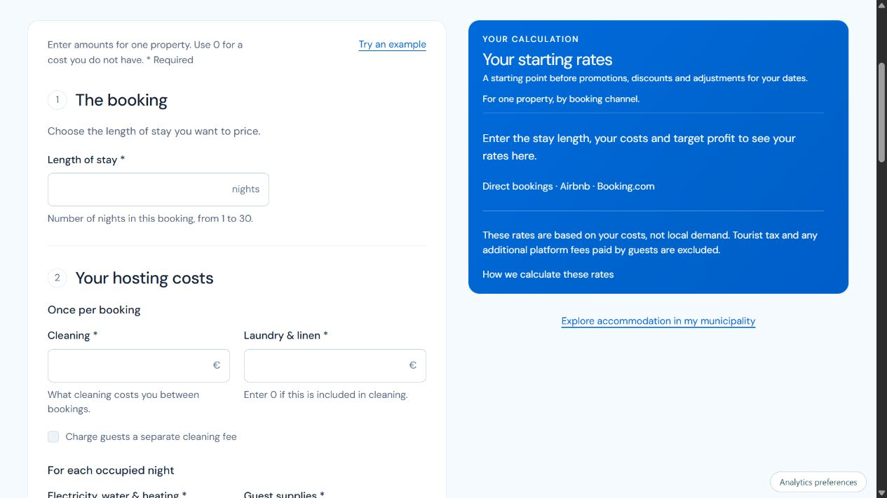
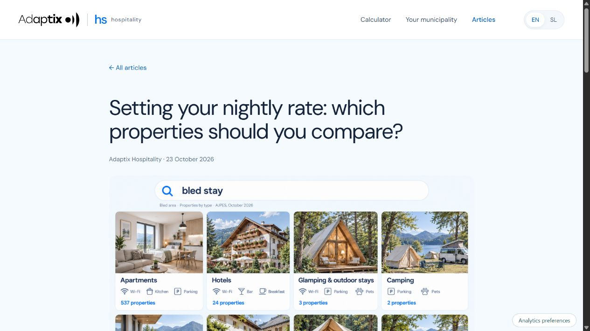
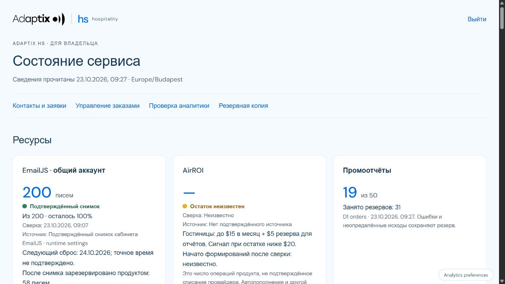

# Adaptix Hospitality

**Pricing and local market intelligence for independent accommodation hosts in Slovenia.**

[Product](https://adaptix-hs.eu) · [Request a report](https://adaptix-hs.eu/report) · [Slovenian report page](https://adaptix-hs.eu/sl/porocilo) · [Architecture](ARCHITECTURE.md) · [Product decisions](PRODUCT-DECISIONS.md)

Adaptix Hospitality helps a host answer three connected questions: **What nightly rate covers my costs? How does my price compare with the local market? What do official data tell me about accommodation supply and tourism in my municipality?**

The live service combines a free cost calculator with a limited launch offer of **50 free market reports**, subject to availability and supported geography. A report can be requested directly or after using the calculator. Email confirmation is required; a marketing subscription is optional.

This showcase describes the implementation at **23 October 2026, after Sprint 3 (version 67)**. The earlier €5 purchase design is retained in the application as a separately gated payment path; paid sales are currently disabled. It is not the current public report journey.

## Who it serves

An independent host renting a room, apartment or holiday home, often as a source of additional income. The host needs an understandable price calculation and a local reference without maintaining a spreadsheet or subscribing to a professional revenue-management platform. The interface and educational articles are available in Slovenian and English.

## The live product experience

### Work out your starting rates

Enter the length of the stay, cleaning and laundry costs per booking, nightly running costs, monthly fixed costs, expected occupied nights and a target profit. Editable commissions support direct bookings, Airbnb and Booking.com.

The result is a starting point before promotions, discounts and date-specific adjustments. A new visit starts with clean inputs; a saved confirmation link still opens its own result. On desktop, the result stays visible alongside the form; on mobile, it follows the form. The result shows two alternative prices: **Break-even rate** and **Rate with profit**. Each includes a booking total, channel fees, payout and profit before income tax. A separate cleaning charge can be added without removing the cleaning expense from the calculation.

The calculator also shows a dated AJPES registered-supply indicator for the selected municipality. Official-data coverage includes all 212 Slovenian municipalities; commercial market coverage is checked separately.

### Request a market report

Choose the municipality, accommodation category and bedroom count, provide an email address and confirm it. Direct report requests do not require invented cost inputs. Requests made after a calculation carry its selected area and inputs into the report.

| Report section | What it contributes |
| --- | --- |
| **My price and the market** | Historical AirROI nightly-rate estimates, reference period and market coverage; a personal price overlay when a calculation was supplied |
| **Hotel context** | Historical AirROI rates for rooms listed for two guests, plus a separate selection of published offers from the hotel radar, where covered |
| **Registered accommodation supply** | AJPES active-establishment counts, types and registered capacity |
| **Tourism context** | SURS municipal guest-night history, seasonality and available comparable periods |

One launch grant is tied to a verified email and municipality. Reopening an existing report reuses its stored snapshot; it does not fetch another commercial dataset. Access expires after 30 days. Provider failures and uncertain outcomes remain visible for review rather than triggering an uncontrolled repeat request.

The ready result opens on the site and is linked in a transactional email. Report readiness and email delivery are tracked separately.

## Sources and meaning

- **AJPES RNO:** registered accommodation establishments and their declared capacity. The importer groups establishments by their actual municipality. [Official source](https://www.ajpes.si/Registri/Drugi_registri/Register_nastanitvenih_obratov/Splosno)
- **SURS SiStat:** published municipal tourism observations. Missing and suppressed values remain explicit. [Source table](https://pxweb.stat.si/SiStatData/pxweb/en/Data/-/2164466S.px/)
- **AirROI:** commercial historical market estimates with explicit geography, property filters and reference months. [Provider documentation](https://www.airroi.com/api/documentation)

These sources describe different populations. Registered establishments, platform listings, registered beds and guest overnight stays are not interchangeable. The report displays dates and coverage; a daily refresh does not make a monthly tourism statistic a daily observation.

## Search, content and measurement

The blog has three translated article pairs. The newest, published on 23 October, explains which accommodation alternatives to compare:

- [Setting your nightly rate: which properties should you compare?](https://adaptix-hs.eu/blog/which-properties-to-compare)
- [Določanje cene na noč: katere nastanitve primerjati?](https://adaptix-hs.eu/blog/katere-nastanitve-primerjati)

The introductory article remains available:

- [How to set your nightly rate](https://adaptix-hs.eu/blog/how-to-set-your-nightly-rate)
- [Kako določiti ceno na noč](https://adaptix-hs.eu/blog/kako-dolociti-ceno-na-noc)

Google indexing was requested for both new article URLs on 23 October; they were not indexed at the inspection checkpoint. Earlier indexing evidence remains historical and does not establish current search traffic.

Canonical and language links, a generated sitemap, article structured data and localized Open Graph cards support discovery and sharing. The report pages have public share images.

Consent-aware analytics follow the path to a ready report. Sixteen registered material links distinguish organic Facebook/LinkedIn posts and Google/Meta ad variants using separate campaign values. Article assistance is preserved separately from acquisition. GA4, Search Console and owner administration provide complementary views; known owner and friend tests are excluded when interpreting actual demand.

Fixed first-party short links now support LinkedIn to EN and Facebook to SL. They redirect to the full article with registered campaign labels; canonical, language, sitemap and internal CTA links stay clean. Both new short links were checked in LinkedIn Post Inspector and Facebook Sharing Debugger.

Google Ads conversion import and Meta server-side measurement have been technically checked. This does not claim a live campaign, advertising performance or customer acquisition.

## Implementation and reliability checkpoint

| Area | Evidence at the end of Sprint 3 |
| --- | --- |
| Report journeys | EN/SL confirmation, consent decline, clean new visits, stored-result reopening and protected report access checked |
| Small samples | Samples below 10 retain the same caution as 10–29; missing price data is explicit and does not block the rest of the report |
| Hotels and radar | Monthly AirROI cache and weekly published-offer radar remain separate; a personal comparison requires an actual calculation |
| Automated checks | 179 tests, TypeScript, production build and built-Worker integration checks passed; 16 material journeys covered |
| Independent morning | Unattended 23 October official-data publication and hourly checks verified; the zero-order daily digest arrived once at 08:03 local time |
| Resources | Dated provider observations and qualified forecasts; shared-account usage is not inferred from this product alone |

An owner-only operations dashboard shows resources, data refreshes, report and mail states, incident transitions, delivery evidence and run history. Status colors also have text labels. The independent monitor and watchdog detect skipped or incomplete checks; unchanged incidents do not trigger repeated urgent notices. A daily 08:00 digest includes zero-order days and unresolved older incidents.

The monthly hotel refresh is capped at $15 with a $5 report reserve, requires a balance observation no older than 24 hours, and avoids buying the same month twice. Its first scheduled paid cycle is **20 November 2026** and remains future acceptance work. Automatic provider-balance retrieval is not yet confirmed; one historical mail attempt remains unresolved and must not be blindly resent.

## Interface

Current public calculator and article, **version 67, 23 October 2026**:

The owner dashboard below uses **synthetic local test data**. Its numbers are not production balances; it contains no customer records or private provider identifiers.

Earlier version 12 screenshots remain in the repository as dated historical assets.

## About this showcase

Product design and development by **Lilly Dubovik / Adaptix**, using ChatGPT and Codex as development tools. Pricing calculations are deterministic; AI does not generate the numerical result.

The application uses React, TypeScript, Vinext and Vite on Cloudflare Workers through OpenAI Sites, with Cloudflare D1 and Drizzle for application state. See [Architecture](ARCHITECTURE.md) for the actual storage and execution boundaries.

This public repository contains product documentation and approved public interface images. Application source, customer records, credentials, private report links and raw supplier datasets remain private. No open-source licence is granted by this documentation update.
