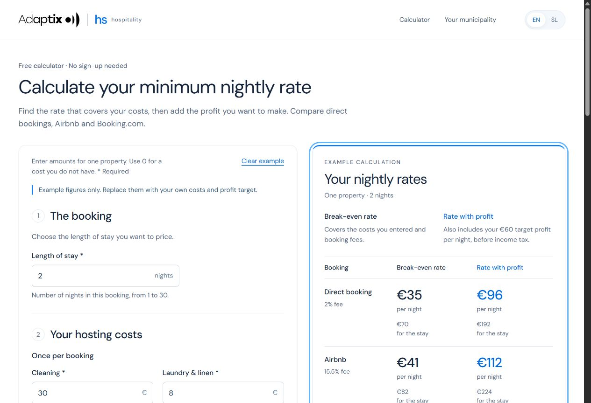
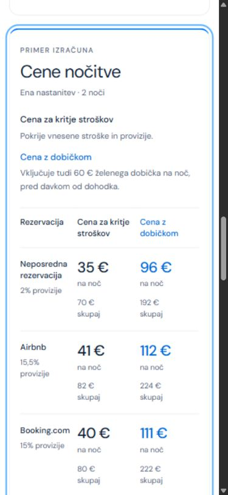

# Adaptix Hospitality

**Pricing and local market intelligence for independent accommodation hosts in Slovenia.**

[Product](https://adaptix-hs.eu) · [Request a report](https://adaptix-hs.eu/report) · [Slovenian report page](https://adaptix-hs.eu/sl/porocilo) · [Architecture](ARCHITECTURE.md) · [Product decisions](PRODUCT-DECISIONS.md)

Adaptix Hospitality helps a host answer three connected questions: **What nightly rate covers my costs? How does my price compare with the local market? What do official data tell me about accommodation supply and tourism in my municipality?**

The live service combines a free cost calculator with a limited launch offer of **50 free market reports**, subject to availability and supported geography. A report can be requested directly or after using the calculator. Email confirmation is required; a marketing subscription is optional.

This showcase describes the implementation at **16 October 2026, after Sprint 2 (version 44)**. The earlier €5 purchase design is retained in the application as a separately gated payment path; paid sales are currently disabled. It is not the current public report journey.

## Who it serves

An independent host renting a room, apartment or holiday home, often as a source of additional income. The host needs an understandable price calculation and a local reference without maintaining a spreadsheet or subscribing to a professional revenue-management platform. The interface and first educational article are available in Slovenian and English.

## The live product experience

### Calculate a sustainable booking price

Enter the length of the stay, cleaning and laundry costs per booking, nightly running costs, monthly fixed costs, expected occupied nights and a target profit. Editable commissions support direct bookings, Airbnb and Booking.com.

The result shows two alternative prices: **Break-even rate** and **Rate with profit**. Each includes a booking total, channel fees, payout and profit before income tax. A separate cleaning charge can be added without removing the cleaning expense from the calculation.

The calculator also shows a dated AJPES registered-supply indicator for the selected municipality. Official-data coverage includes all 212 Slovenian municipalities; commercial market coverage is checked separately.

### Request a market report

Choose the municipality, accommodation category and bedroom count, provide an email address and confirm it. Direct report requests do not require invented cost inputs. Requests made after a calculation carry its selected area and inputs into the report.

| Report section | What it contributes |
| --- | --- |
| **My price and the market** | Historical AirROI nightly-rate estimates, reference period and market coverage; a personal price overlay when a calculation was supplied |
| **Registered accommodation supply** | AJPES active-establishment counts, types and registered capacity |
| **Tourism context** | SURS municipal guest-night history, seasonality and available comparable periods |

One launch grant is tied to a verified email and municipality. Reopening an existing report reuses its stored snapshot; it does not fetch another commercial dataset. Access expires after 30 days. Provider failures and uncertain outcomes remain visible for review rather than triggering an uncontrolled repeat request.

The ready result opens on the site and is linked in a transactional email. Report readiness and email delivery are tracked separately.

## Sources and meaning

- **AJPES RNO:** registered accommodation establishments and their declared capacity. The importer groups establishments by their actual municipality. [Official source](https://www.ajpes.si/Registri/Drugi_registri/Register_nastanitvenih_obratov/Splosno)
- **SURS SiStat:** published municipal tourism observations. Missing and suppressed values remain explicit. [Source table](https://pxweb.stat.si/SiStatData/pxweb/en/Data/-/2164466S.px/)
- **AirROI:** commercial historical market estimates with explicit geography, property filters and reference months. [Provider documentation](https://www.airroi.com/api/documentation)

These sources describe different populations. Registered establishments, platform listings, registered beds and guest overnight stays are not interchangeable. The report displays dates and coverage; a daily refresh does not make a monthly tourism statistic a daily observation.

## Search, content and measurement

The first article is published in both languages:

- [How to set your nightly rate](https://adaptix-hs.eu/blog/how-to-set-your-nightly-rate)
- [Kako določiti ceno na noč](https://adaptix-hs.eu/blog/kako-dolociti-ceno-na-noc)

As checked on 16 October, both articles and the English homepage were indexed by Google. Other pages and sitemap processing still require follow-up; this is evidence of initial visibility, not established search traffic.

Canonical and language links, a generated sitemap, article structured data and localized Open Graph cards support discovery and sharing. The report pages have public share images.

Consent-aware analytics follow the path to a ready report. Twelve registered material links distinguish organic Facebook/LinkedIn posts and Google/Meta ad variants using separate campaign values. Article assistance is preserved separately from acquisition. GA4, Search Console and owner administration provide complementary views; known owner and friend tests are excluded when interpreting actual demand.

Google Ads conversion import and Meta server-side measurement have been technically checked. This does not claim a live campaign, advertising performance or customer acquisition.

## Implementation and reliability checkpoint

| Area | Evidence at the end of Sprint 2 |
| --- | --- |
| Report journeys | Direct report and calculator-to-report paths checked in EN/SL, including confirmation on another device, reopening and duplicate prevention |
| Delivery | A real test report was received and reopened; regression checks use intercepted provider calls |
| Automated checks | 98 unit tests, TypeScript and production build passed; 12 existing runtime groups and 12 material-attribution journeys passed |
| Official-data refresh | Daily 07:00 Europe/Budapest schedule; an unattended 16 October refresh and publication confirmed |
| Independent monitor | Hourly schedule enabled; autonomous 16 October run and Gmail delivery confirmed; 15 October silent-run history remains unverified |
| Commercial rollout | Content and measurement handoff prepared; final creatives, budget and channel launch settings remain separate launch decisions |

The monitor is separate from the data updater and uses an independent notification channel. An autonomous result appeared on 16 October at 12:08 Europe/Budapest; the corresponding recovery email was verified in both Sent and the recipient Inbox. This confirms current execution and notification delivery, not every historical silent run.

## Interface

These archived screenshots show the free calculator in **version 12, 7 October 2026**. They document the earlier interface; the live links above provide the current report and article experience.

Slovenian mobile calculator — archived version 12

## About this showcase

Product design and development by **Lilly Dubovik / Adaptix**, using ChatGPT and Codex as development tools. Pricing calculations are deterministic; AI does not generate the numerical result.

The application uses React, TypeScript, Vinext and Vite on Cloudflare Workers through OpenAI Sites, with Cloudflare D1 and Drizzle for application state. See [Architecture](ARCHITECTURE.md) for the actual storage and execution boundaries.

This public repository contains product documentation and approved public interface images. Application source, customer records, credentials, private report links and raw supplier datasets remain private. No open-source licence is granted by this documentation update.
